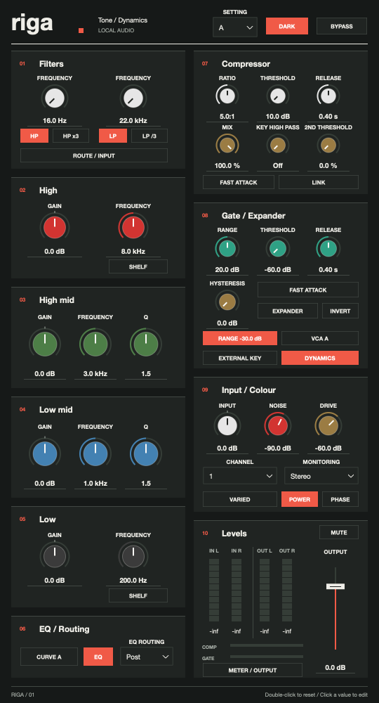

# RIGA

Tone shaping, dynamics and analogue colour in a Swiss-inspired channel strip. Available as VST3 and a standalone application on macOS, Windows and Linux.



Riga combines filters, a compressor, a gate/expander and a four-band EQ in a compact, Swiss-inspired interface. Its 540 × 1000 vector editor uses a narrow two-column grid, colour-coded knobs and a dark theme. The header theme button switches to warm off-white surfaces.

## Controls

- High-pass and low-pass filters with extended frequency ranges and flexible routing.
- Compressor with fast attack, mix, stereo linking, detector high-pass and a second threshold control.
- Gate/expander with hysteresis, inversion and selectable threshold range.
- Four-band EQ with two curves, high/low shelf or bell modes, and adjustable mid-band Q.
- Input/output gain, drive, noise, channel variation and stereo monitoring.
- Mono and stereo processing, external sidechain input and zero reported latency.
- 54 host parameters, automation, four independent A–D settings and saved plugin state.

The low EQ knobs change from charcoal to brown with the EQ curve. Gate knob colours follow the threshold range. Double-click a knob to reset it; click its value to enter a number.

## Build

Requires CMake 3.22 or newer, a C++17 compiler and JUCE 8.0.13. CMake downloads JUCE automatically; use `-DJUCE_PATH=/path/to/JUCE` to use a local checkout instead.

On Linux, install the ALSA, JACK, FreeType, Fontconfig and X11 development packages listed in `.github/workflows/build.yml`. On macOS, install the Xcode command-line tools. On Windows, use a Visual Studio developer shell with the C++ tools and Windows SDK installed.

```sh
cmake -S . -B build -DCMAKE_BUILD_TYPE=Release
cmake --build build --config Release --parallel 4
ctest --test-dir build -C Release --output-on-failure
```

Build outputs are in `build/Riga_artefacts/Release/`:

| Format | macOS | Windows | Linux |
|---|---|---|---|
| VST3 | `VST3/Riga.vst3` | `VST3/Riga.vst3` | `VST3/Riga.vst3` |
| Standalone | `Standalone/Riga.app` | `Standalone/Riga.exe` | `Standalone/Riga` |

## Install

Close your audio host before replacing an installed plugin.

- **macOS:** copy the complete `Riga.vst3` bundle to `~/Library/Audio/Plug-Ins/VST3/`. Copy `Riga.app` to `~/Applications/`.
- **Windows:** copy the complete `Riga.vst3` directory to `C:\Program Files\Common Files\VST3\`. Keep the standalone executable in a folder of your choice.

- **Linux:** copy the complete `Riga.vst3` directory to `~/.vst3/`. Keep the standalone `Riga` executable in a folder of your choice.

Restart your host and rescan plugins if necessary. Release archives are platform-specific: the current macOS package targets Apple Silicon; the Windows and Linux packages target x64.

## Development

The DSP renderer and regression checks can build without JUCE:

```sh
cmake -S . -B build-dsp -DSTRIP_DSP_ONLY=ON -DCMAKE_BUILD_TYPE=Release
cmake --build build-dsp --config Release --parallel 4
ctest --test-dir build-dsp -C Release --output-on-failure
```

Enable `-DSTRIP_EDITOR_CHECK=ON` in a JUCE build for the editor snapshot and state checks. Run `strip-editor-check` with optional dark and light output PNG paths. The checks verify that every control fits without overlaps and that theme switching works.

`strip-render` reads and writes little-endian, interleaved stereo float32 audio without a file header:

```text
strip-render input.f32 output.f32 [parameters.txt] [sample-rate] [block-size] [noise-seed] [settle-frames]
```

Parameter files contain one stable key and normalized value per line, such as `highGain 0.75`. Keys and defaults are defined in `Source/Parameters.h`. A fixed noise seed makes repeated renders deterministic. The optional settling interval processes silence and clears audio history before rendering.

Compare two renders with:

```sh
python3 tools/compare_audio.py expected.f32 actual.f32 --maximum-error 0.00002
```

See [validation notes](docs/validation.md) for test coverage and [contribution notes](CONTRIBUTING.md) for the project structure.

## Automated builds

The GitHub Actions workflow builds and tests Windows x64 and Linux x64 VST3 and standalone binaries on pushes, pull requests and manual runs. Linux editor checks use a virtual display. Platform archives are retained for 30 days.

Version tags beginning with `v` create a draft release containing the validated Windows and Linux archives. Add the locally built, signed macOS package before publishing the draft. macOS release binaries are built locally on Apple Silicon.

Create local archives with:

```sh
python3 tools/package.py --architecture arm64
```

Use `--architecture x64 --platform Windows` on Windows, `--architecture x64 --platform Linux` on Linux, or `--source-only` to package just the source. Output is written to `dist/`, with SHA-256 checksums. macOS release bundles should be signed before packaging; the local release build uses ad hoc signatures.

## Source layout

- `Source/`: processing, parameter mappings, session handling and vector editor.
- `tools/`: offline renderer, editor checks, audio comparison and packaging.
- `tests/`: DSP regression checks and numerical fixtures.
- `docs/`: interface preview and validation notes.

## Dependencies

The plugin and standalone application use JUCE. Check JUCE's license terms for your intended use and distribution.
